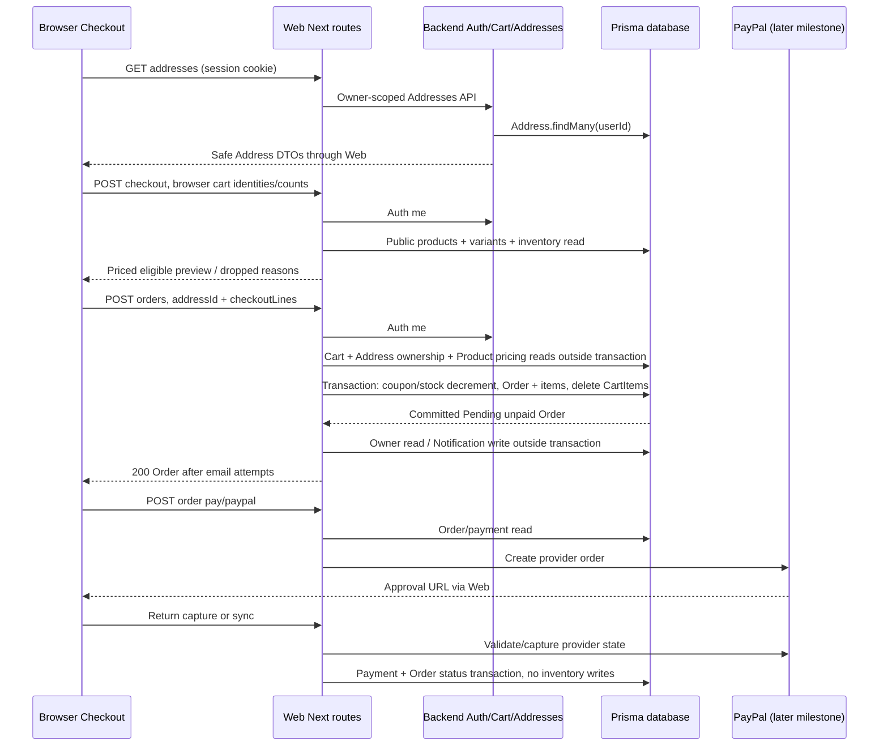
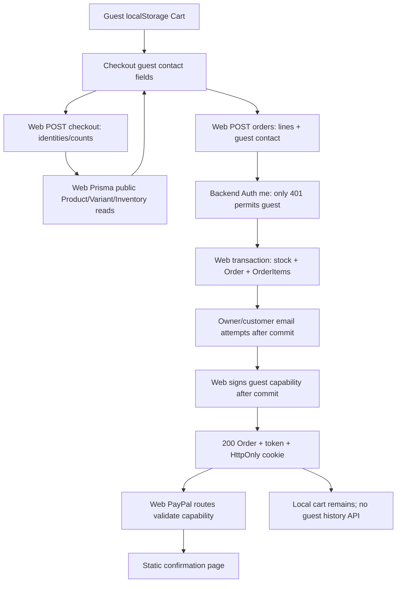
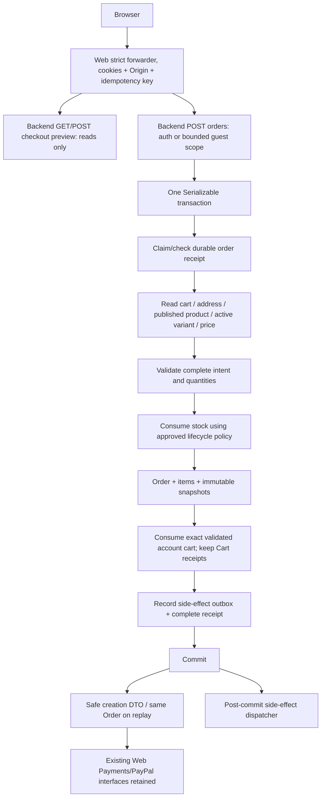

# Checkout and Orders Backend ownership audit

Audit date: 2026-10-03. Architecture only; no implementation authorization is implied by this document.

## Evidence scope and notation

- **W** = `/home/dci-student/projects/marihandmade-web`, branch `feat/wishlist-backend-cutover`, revision `2d500ef`.
- **B** = `/home/dci-student/projects/marihandmade-backend`, branch `feat/wishlist-backend`, revision `63baf79`.
- **A** = `/home/dci-student/projects/mariHandmade`, inspected read-only for shared schema history and Admin dependencies. Its legacy storefront is not the active Web repository.
- Paths prefixed W/B/A below are exact repository-relative source citations. Function names and line ranges identify the audited sections; they are evidence, not proposed filenames unless explicitly labeled proposed.
- Inspected application source, generated Web schema, canonical Backend schema, migration SQL, existing tests and migration documentation. No application, database client, migration, seed, smoke, PayPal request or email request was executed. No environment secrets or production records were read. Only this document was written.
- Production inventory values and smoke order `cmuny0za20004n8ti6gg9vx2i` are user-provided context, not independently verified evidence. Nothing here establishes the cause of any production depletion.
- Database referential actions below describe the canonical schema or cited SQL. Deployed constraints and migration ledger remain unverified.

## 1. Executive summary

Checkout and storefront Orders still belong to Web. Backend owns customer session identity, authenticated Cart and Addresses, but Web directly reads products/inventory and writes Order, OrderItem, stock and cart consumption. The two intentional Cart exceptions are still exactly `prisma.cart.findUnique` and transactional `tx.cartItem.deleteMany` in W `src/app/api/orders/route.ts:186,517`.

The smallest boundary preserving both authenticated and guest checkout is **GET/POST `/api/checkout` for read-only previews, POST `/api/orders` for authoritative commit, and GET `/api/orders` + GET `/api/orders/:orderId` for safe reads**. Preview POST is necessary for guest local-cart lines; GET alone cannot carry them without putting customer/cart data in URLs or introducing a guest server cart. Order creation must independently validate everything inside one Backend transaction. Preview is never a reservation or a guarantee.

High-priority findings:

| Finding | Evidence and implication |
| --- | --- |
| Stock is consumed before payment | W Orders POST transaction, lines 392–459; quantityOnHand is decremented for tracked variants, legacy Product.stock otherwise. Order is Pending and unpaid. No reservation increment occurs. |
| Payment success does not consume stock | W `src/lib/paypal.ts::reconcilePayPalPayment` writes PaymentProvider, Payment and Order only. No second decrement of the same Order appears in audited runtime code. |
| No restoration lifecycle exists here | No audited cancellation/payment-failure handler restores quantityOnHand, quantityReserved or legacy stock. PayPal cancellation navigates to static confirmation. Pending abandoned orders can retain stock consumption. |
| No order idempotency | W Orders POST has no key, receipt, unique intent constraint or replay path. Different concurrent calls can create duplicate orders. Cart emptiness only helps a later request that reads after commit. |
| Cart/price/eligibility reads are outside transaction | W Orders POST lines 186–378. Concurrent cart edits can be erased by blanket delete; prices/publication/address can change between validation and commit. |
| Variant omission bypasses structured-product policy | W Checkout and Orders use legacy stock when variantId is absent even if variants exist. B `modules/cart/prisma.ts::validateIncrease` correctly requires explicit variants for structured products. Guest/direct POST remains exposed to the discrepancy. |
| Full User serialization | W `src/app/api/orders/[orderId]/route.tsx::GET` includes `user: true`, then `NextResponse.json(order)`. passwordHash, OTP and other security scalars can be returned. |
| Notification identity mismatch | W Orders POST maps `Owner.id` to `Notification.userId`; FK references User.id. A missing matching User row causes P2003. The actual offending production ID is not proven. |
| Mutable historical data | OrderItem stores count/price/discount, but no title/SKU/image snapshot. Order.address is a nullable FK, with no shipping snapshot. History uses live Product/Variant/Address. |
| Guest support is real but incomplete | Guest order creation and payment capability are coded; shipping address is not collected, local cart is not cleared, history is authenticated only, confirmation does not read an order. Canonical guest Payment raw SQL has a separate later-milestone risk. |

Recommended incremental migration: durable order-creation receipt and immutable order snapshots; transactional side-effect outbox if reliable notification/email delivery is required. These require a **new narrowly scoped additive migration**, not replay of historical full-schema SQL. Preserve current consume-on-create inventory timing for an ownership-only change unless the user approves reservation/expiration/cancellation semantics separately.

## 2. Current Checkout architecture

### Browser and presentation

W `src/app/(store)/checkout/page.tsx::CheckoutPage` is a client component. State is local React state: address list/id/loading/error, guest email/first/last/phone, loading, createdOrderId, guestOrderAccessToken and paypalError. There is no durable checkout-intent state or persisted idempotency key.

| Step / function | Input → output | Reads / writes | Trust boundary |
| --- | --- | --- | --- |
| W `src/hooks/useAuthentication.tsx::useAuthenticated` | Auth status → authenticated/loading/error | No DB; reads shared Auth context | Browser identity is presentation only; backend auth must remain authoritative. |
| W `src/state/Cart.tsx::CartContextProvider`, `refreshCart` | Auth identity → account cart via client-cart or local guest cart | B Cart reads for authenticated users; localStorage for guests | Guest local content is untrusted; authenticated cart belongs to Backend. |
| CheckoutPage `requestLines` useMemo | cart.items → productId, variantId, quantity | No DB writes | Filters positive counts; no authority for identity, price or eligibility. |
| CheckoutPage address effect | authenticated account → `profileAddresses.addresses()` | W/B addresses HTTP, owner-scoped B DB read | First/newest address is selected; account change clears selection. Failure blocks checkout. |
| CheckoutPage `handleCheckout` guards | auth/cart/address loading + guest fields | No DB | Prevents guest submit during auth loading/error; does not inspect Cart context's error field. |
| `fetch('/api/checkout', POST)` | `{lines: requestLines}` → lines/readiness flags | W Product/Variant/Inventory read | JSON has no current strict runtime request schema, Origin guard or explicit body bound. |
| `fetch('/api/orders', POST)` | addressId, **entire preview lines**, guest contact | See Order transaction below | Preview price/subtotal are currently sent, but ignored by order repricing. |
| `startPayPalPayment` | created Order.id and optional guest capability → approval URL | W order read, external PayPal create | Payment is a separate post-creation operation. No rollback of order on PayPal failure. |

Checkout does not render line prices or a final totals breakdown on this page. W `src/app/(store)/(routes)/cart/components/receipt.tsx::calculatePayableCost` displays product-price totals, product discounts, 9% tax and `$` labels. It ignores selected variant prices and can therefore disagree with commit pricing. This is a correctness issue, not authorization to restyle the storefront.

Address creation is not inline in Checkout. W `src/app/(store)/(routes)/profile/addresses/components/addresses-client.tsx::createAddress/deleteAddress` uses existing Backend address APIs; editing lives under profile address routes. Checkout labels shipping address optional and explicitly permits orders with no saved address. Guest fields have no street/city/country/postal input. Shipping cost is not quoted; Order POST hardcodes shipping 0 and shippingStatus PENDING.

### Web preview route

W `src/app/api/checkout/route.ts`:

- `GET`: calls `getCurrentUserId`; requires authenticated identity, calls `getRequestedLinesFromUserCart` → B `/api/cart` with current cookies, validates DTO/userId, then `resolveCheckoutLines`. No direct Web Cart Prisma read remains in preview.
- `POST`: optionally resolves authenticated identity; accepts aliases `lines`, `checkoutLines`, `items`. Nonempty supplied lines win even for authenticated users. Otherwise uses account cart, or returns 400 for guest empty input. Malformed JSON becomes `{}`; unknown keys are not rejected.
- `normalizeLineInputs`: converts quantity/count with `Number`, checks positive integers, merges duplicate `(productId, variantId)` pairs. No upper bound, aggregate overflow check, exact trimmed ID check or strict variant type check.
- `resolveCheckoutLines`: `prisma.product.findMany(withPublicProductWhere(...))`, selecting titles/prices/images/stock and nested variants/inventory. Validates selected variant belongs to product and is active. Uses inventory helper for variants, legacy stock helper for omitted variant. Missing/invalid/unavailable lines are dropped; returns reasons and count. Does not persist anything.
- Output aliases items/lines plus lineCount/itemCount/droppedLineCount/hasDroppedLines/isCheckoutReady/requiresCartReview/droppedReasons. `isCheckoutReady` is true when no lines were dropped, even if empty; browser separately rejects empty lines.
- Preview subtotal = quantity × server unit price; compareAtPrice is presentation only. Preview does not compute product discounts, tax, payable or shipping totals.
- Visibility predicate W `src/lib/public-products.ts::getPublicProductWhere`: status ACTIVE, or status null + isAvailable true, and publishedAt null or <= now. Explicit ACTIVE products are not globally gated on isAvailable; variant eligibility and legacy eligibility differ.
- Exceptions log raw error and return plaintext 500. These routes do not explicitly set private/no-store response headers or validate trusted Origin. Next cookie usage makes routes dynamic, but is not a substitute for HTTP cache policy.

## 3. Current Orders architecture

All active customer order creation found in W/B is W `src/app/api/orders/route.ts::POST`. It has one authenticated branch and one guest branch. B has no Orders/Checkout module or order-creation route (`src/app.ts::buildApp`, `src/server.ts`). No other active W Order.create path or OrderItem direct creator was found. A legacy storefront copy is not a separate active path in these deployed repositories.

### Pre-transaction sequence

| Exact W function/section | Input / output | DB reads | DB writes / boundary |
| --- | --- | --- | --- |
| `getCurrentUserId` via `src/lib/auth.ts` | request cookies → B-authenticated User.id or null | B Auth session/user | Only B 401 becomes guest; outages and other errors throw, not anonymous fallback. |
| Orders POST body destructuring | addressId/discountCode/checkoutLines/guest | None | Unknown fields ignored; JSON/type failures can produce 500. No trusted-Origin/content-type/body-limit guard here. |
| guest normalization lines 125–147 | email trimmed/lowercased, names trimmed, optional phone | None | Missing first/last/email or regex failure → 400. No guest address creation. |
| account Cart read lines 186–229 | identity userId → Cart with items/product/variant and user.email | `prisma.cart.findUnique` owner-scoped | Outside transaction; empty/missing → 400. Client userId is never used. |
| discount precheck lines 231–242 | discountCode → matching usable row | `prisma.discountCode.findFirst(code, stock>=1)` | No date/percent/maxDiscountAmount logic applied. |
| normalize and exact cart-map comparison lines 244–287 | submitted lines or persisted cart → requestedLines | Already-read cart | Submitted authenticated map must exactly match full cart map; mismatch → 409. All requestedLines still come from a pre-transaction snapshot. |
| address check lines 289–298 | optional addressId + userId → owned ID | `prisma.address.findFirst({id,userId})` | Only if authenticated and truthy addressId. Guest addressId is ignored; absence permitted. |
| product repricing lines 300–376 | requested identities → pricedLines | public Product + active variants + inventory | Ignores browser prices/subtotals/discount values. Product may still fall through to legacy stock if variant omitted. |
| `calculateCosts` lines 613–632 | counts, server unitPrice, product.discount → totals | None | Arithmetic is outside transaction and uses Float/JS numbers, rounding each aggregate to 2 decimals. |

Cost formula: total = Σ(count × variant.price or product.price); discount = Σ(count × product.discount); tax = (total − discount) × 0.09; payable = total − discount + tax; shipping = 0. Coupon percent/maxDiscountAmount/startDate/endDate do not affect the amount, even though its stock is consumed. No validation bounds discount <= price, finite/nonnegative monetary totals, or payable > 0 until payment handoff. W `src/lib/order.ts` contains other discount/referral utility functions, but Orders POST does not call them.

### Transaction and resulting record

W Orders POST lines 380–525 uses one interactive `$transaction` without explicit isolation level or retry policy:

1. Optional DiscountCode.updateMany conditionally decrements usage stock; failure throws DISCOUNT_EXHAUSTED.
2. Inventory/legacy stock is conditionally consumed for every priced line (section 6).
3. OrderCreateInput sets Pending, total/tax/payable/discount, shipping 0, shippingStatus PENDING, optional discount FK; nested OrderItems create count, price, discount and Product/Variant connections.
4. Connect authenticated User or write nullable guest contact fields. Connect owned Address only if userId and addressId were supplied.
5. `tx.order.create` returns Order scalar record, not included User/Product objects.
6. `tx.cartItem.deleteMany({cartId:userId})` removes **every current account cart item**. It does not update Cart.updatedAt or delete CartMutationReceipt.
7. Commit and return createdOrder. Nested items, stock, coupon usage and cart delete roll back together if transaction fails.

Order.id is Prisma cuid; number uses DB autoincrement/SERIAL unique sequence, not client input or max+1. Sequence gaps on rollback are possible; number is not an idempotency key. createdAt uses now default; updatedAt is Prisma-managed. isPaid/isCompleted default false. No Payment is created here; no payment-status field on Order beyond isPaid/status. Price/count/discount are snapshots; product title/SKU/image, customer account email/name, and shipping address are not snapshots.

Post-commit notification/email flow then runs synchronously before HTTP response. Guest capability creation also occurs **after commit** and can throw (e.g. absent signing secret), resulting in 500 despite committed Order/stock. Success returns raw Order scalars with status 200; guest also receives token JSON and cookie. Known insufficient-stock/coupon transaction errors map to generic plaintext 400; everything else plaintext 500 and raw log.

## 4. Complete request/data-flow diagrams

### Authenticated current flow



Alternative authenticated preview GET reads Cart through B first; browser's normal handleCheckout uses POST.

### Guest current flow



### Proposed ownership and commit



## 5. Current Prisma ownership map

| Domain | Current authority | W direct persistence still present | Future authority |
| --- | --- | --- | --- |
| Catalog display | B HTTP Catalog | Checkout/Orders eligibility product reads; reviews/content exceptions | B preview + commit; unrelated reviews remain separate |
| Customer Auth | B | W auth helper forwards cookies, not caller IDs | B session identity, including fail-closed optional auth |
| Addresses | B CRUD | Orders ownership read + FK connection; SSR order include | B transaction ownership/snapshot read |
| Authenticated Cart | B | Exactly W Orders pre-transaction read + tx item delete | B transaction only |
| Guest Cart | Browser localStorage | No guest server Cart | Preserve browser input/cleanup; validate identities server-side |
| Checkout | W read/price logic | Product/Variant/Inventory query | B read-only preview |
| Order/OrderItem | W | create, history/detail, status write in PayPal | B storefront create/read; temporary PayPal status exception |
| Inventory sale consumption | W Orders | InventoryItem and Product.stock decrement | B Order commit, no Cart mutation |
| Owner notification/customer email | W Order post-commit | Owner.findMany/Notification.createMany | B side effects, with valid recipient model decision |
| Payment/PayPal | W | provider/payment/order reconcile transaction | Remains W until separate milestone |
| Admin | A separate application | Not part of active W | Unchanged; continues shared-schema compatibility |

Infrastructure W `src/lib/prisma.ts` constructs the frozen generated Prisma 5.22 client. Keeping it for payment/unrelated exceptions is distinct from allowing storefront Order creation/history to continue using it.

## 6. Inventory mutation analysis — high priority

### Active W/B runtime code

| Path/function | Exact behavior |
| --- | --- |
| W Checkout `resolveCheckoutLines` | Reads quantities/flags; drops ineligible lines. No decrement, reserve, movement or cart write. |
| W Orders POST, variant branch lines 394–443 | Reads InventoryItem in transaction; missing inventory fails. Untracked inventory skips mutation. Tracked availability = onHand − reserved. No backorder: insufficient fails; updateMany matches previously read onHand/reserved + trackQuantity=true/allowBackorder=false and decrements onHand by item.count; count=0 fails. Backorder: update unconditionally decrements onHand, allowing negative values. |
| W Orders POST, legacy branch lines 445–457 | Product.updateMany where id + stock>=count + isAvailable=true; decrement Product.stock by count. No variant inventory mutation for this branch. |
| W Orders coupon branch | DiscountCode.stock decrement is coupon usage, not physical inventory. Keep it distinct in migration/tests. |
| W `src/lib/paypal.ts::reconcilePayPalPayment` | No inventory or stock reads/writes, only PaymentProvider/Payment/Order. Capture/sync/webhook call it. |
| B `src/modules/cart/prisma.ts::validateIncrease/mutate` | Reads eligibility and inventory for increases, writes Cart/CartItem/CartMutationReceipt. Never reserves/decrements inventory, Product.stock or StockMovement. |
| B Wishlist repository | Connect/disconnect membership only. No stock writes. |

`quantityReserved` is only read by checkout/order/cart in active W/B. No reservation increment/decrement, InventoryItem create/delete, StockMovement create or stock restoration path appears in active W/B runtime source. OrderStatus enum contains Cancelled/Denied/refund states, but this does not implement inventory restoration. W `/api/orders/[orderId]/ship` always returns 404. No storefront cancellation mutation route exists.

The **same Order** is not decremented again during payment/capture/sync/webhook in this code. However duplicate order-creation requests produce **different Orders**, each eligible to decrement stock. Browser retries are not tied to a stable existing Order unless createdOrderId survived and the user chooses the dedicated PayPal retry.

### Concurrency in current stock consumption

- Non-backorder variant compare-and-swap guards onHand/reserved against competing updates. A loser fails/rolls back rather than silently overselling that tracked row; no retry policy currently exists. The check is stronger than a read-then-unconditional-decrement.
- Legacy conditional stock>=count decrement similarly bounds stock under concurrent updates.
- Backorder deliberately permits negative onHand. Its unconditional branch can act on stale trackQuantity/allowBackorder flags after concurrent Admin changes; pre-transaction variant active/publication/prices are also not rechecked.
- These guards protect inventory quantity in those branches; **they do not prevent two purchases of the same cart if enough stock exists**, nor prevent erasing concurrently added cart lines.
- Missing variantId falls back to legacy stock even for products with variants. Thus a guest/direct order request can avoid variant-zero-stock enforcement if Product.stock independently allows it. Future commit must reuse B's explicit-variant requirement for structured products.
- BundleComponent and personalization fields are not traversed by current checkout/order stock consumption. Purchasing a bundle does not recursively decrement component inventory here. Do not invent such behavior in ownership migration.

### Other repository stock writers, inspected read-only

These are not authorization to change Admin, run scripts, or attribute production history:

| Exact A source | Mutation |
| --- | --- |
| `apps/admin/src/lib/inventory.ts::ensureInventoryItem` | Creates missing inventory with onHand=0, reserved=0, tracked=true, backorder=false. |
| Same file `postReceivingDocument` | Serializable transaction creates RECEIPT StockMovement rows, increments onHand by receiving line quantity, marks document POSTED/postedAt. Called by `apps/admin/src/app/api/receivings/[receivingId]/post/route.ts::POST`. |
| Same file `createStockAdjustment` | Serializable transaction creates ADJUSTMENT_IN/OUT movement and increments onHand by signed delta; no-backorder underflow guard. Called by `apps/admin/src/app/api/inventory/adjustments/route.ts::POST`. Does not decrement reserved. |
| `apps/admin/src/app/api/products/route.ts::POST/replaceProductStructure` and `.../products/[productId]/route.ts::PATCH/replaceProductStructure` | Writes supplied legacy stock; replaces variants and InventoryItems, initializing onHand from payload, tracked/backorder from payload; reserved defaults 0. Delete/recreate can discard an existing reserved value and changes IDs. FK dependencies can block deletion. No movement is recorded for replacement. |
| `.../products/[productId]/route.ts::DELETE` | Deletes InventoryItems/variants as part of product cleanup; restricted movement dependencies may prevent it. |
| `packages/prisma/prisma/seed.ts::resetProductState/createVariants/seedProduct` | Deletes old InventoryItems/variants before replacement, creates inventory from variantSpec.stock (reserved defaults 0), and sets legacy stock to summed variant stock. A script, not Checkout; never run here. |
| `packages/prisma/prisma/scripts/backfillCatalogPhase1.ts` inventory block | Creates missing inventory from Product.stock, reserved=0, tracked=product.isPhysical, backorder=false, guarded by dryRun. Never run here. |

Generated clients/SQL fixture files describe operations but are not additional live handlers. Unit/isolated-DB test setup writes test inventory; not a production writer. A legacy storefront's Orders implementation must not be re-enabled alongside B. Actual external/manual jobs or deployed older versions are outside repository evidence.

### Implication for the prior smoke

A successful current-code Order POST containing a tracked variant would theoretically consume onHand **even if PayPal fails later**. That is a possible mechanism for depletion, not proof about `cmuny0za20004n8ti6gg9vx2i`. With the user-described current ten variants (tracked, onHand=0, reserved=0, no backorder), a legitimate positive-quantity variant purchase must fail now. Do not raise stock to make tests pass and do not use that real order to investigate production.

## 7. Cart → Order transaction analysis

The exact retained Web Cart accesses are verified by W `src/app/api/orders/route.ts`, and documented in W `docs/cart-backend-cutover.md::Retained Orders exceptions` and B `docs/cart-api.md`:

1. `prisma.cart.findUnique({where:{userId},include:{user:{select:{email:true}},items:...}})` before the transaction.
2. `tx.cartItem.deleteMany({where:{cartId:userId}})` after nested Order creation, inside its transaction.

Preview GET uses B HTTP Cart instead; there is no Web Cart persistence there. Existing W `tests/orders-cart-transition.test.ts` covers owner scope, variant repricing, inventory-change rejection, consumption failure rollback and mismatched lines. Its transaction is an in-memory rollback simulation; it cannot prove PostgreSQL concurrency.

Recommended B boundary: **yes, one transaction** encompassing cart read, exact-intent comparison, address ownership, authoritative product/variant reads and repricing, final inventory check/write, Order/OrderItem/snapshots, cart consumption, idempotency receipt and (if adopted) outbox. HTTP cart GET/clear must not occur inside that workflow; use the same transaction client and database.

| Event | Current risk / required future result |
| --- | --- |
| One item unavailable | Preview drops it; browser refuses partial checkout. Commit currently fails whole order. Preserve whole-cart rejection with safe line reasons; no silent partial purchase/consumption. |
| Quantity too high | Whole commit rejected, all stock/cart/order/coupon changes roll back. Counts must be bounded after merging, not just individual lines. |
| Address invalid/deleted | Current precheck may race FK connection and fail generically. Future transaction revalidates owned address, snapshots it, returns safe missing/conflict. |
| Failure halfway | All DB business effects and receipt/outbox roll back. No emails/remote payment calls in transaction. |
| Two order requests same cart | Current requests can both read cart before consumption and both create orders. Future Serializable transaction + exact cart intent makes one win, other replay same key or receive CART_CHANGED/EMPTY for different key. |
| Concurrent cart edit | Current blanket delete can remove new lines not priced into the Order. Future transaction includes cart predicate reads/deletes; Serializable conflict retries re-read and compare full expected map, then reject changed intent. |
| Success response lost | Current later account retry usually sees empty cart and fails without recovering Order; concurrent retries/guests can duplicate. Future same key returns original Order independently of current cart/inventory. |

Keep CartMutationReceipt rows: replay of earlier cart operations must not refill consumed cart. Update Cart.updatedAt on successful consumption so future readers see the mutation. Do not use Cart.updatedAt alone as idempotency or rely on it as a perfect version: not every existing Cart mutation/legacy consumer updates it.

## 8. Address ownership and snapshot analysis

Current Order.addressId is optional and references Address.id. No shipping-address scalar fields or JSON snapshot exist on Order. Orders POST checks `(id,userId)` before commit and only connects for authenticated users. A supplied other-user address ID is rejected (400), not connected; a guest addressId is ignored. That ownership protection should move inside B transaction and use backend identity only.

W profile order-detail page includes and renders live Address. B `src/modules/addresses/prisma.ts::update` allows owner-scoped edits even if an Order uses the address; old order history changes on edit. `delete` explicitly refuses used addresses in a Serializable transaction (`orders:{none:{}}`), throwing AddressInUse → 409 via `service.ts::delete`. Schema/default and shipping SQL FK are ON DELETE SET NULL; the current application guard intentionally prevents historical detachment. A different DB writer can still invoke FK behavior.

Recommended minimal additive correction: keep nullable addressId for compatibility, add immutable shippingSnapshot capturing country/address/city/phone/postalCode and appropriate recipient fields when available. Keep current optional address UX unless a separate requirement makes shipping mandatory. For new guest orders without a collected address, shippingSnapshot=null; do not manufacture an address or create a fake User. For legacy orders use live address only as explicitly labeled legacy fallback, not a claimed historical snapshot. Do not rewrite production history automatically or loosen existing Address deletion guard during this milestone.

Product snapshots should similarly hold committed productTitle/variantTitle/SKU and optional image for each OrderItem. Customer contact snapshot should capture only required business data (account email/name or guest names/email/phone), never an entire User. These preserve order facts when addresses/catalog/accounts change. With a migration already required for durable idempotency, these are small related additions; the exact field layout requires SQL/model review.

## 9. Guest checkout analysis

Guest checkout is coded end-to-end up to order creation and payment capability; it is not merely marketing text. Existing W `tests/auth-checkout.test.tsx` exercises mocked guest submission/token handoff, and `tests/auth-payments.test.ts` exercises capability authorization. They do not prove live provider or database success.

W `src/middleware.ts::middleware` always passes through and its matcher covers profile/wishlist, not checkout. W `src/app/(store)/layout.tsx` renders children without an authentication gate. The checkout component's explicit loading/error guards, rather than middleware, control guest submission. Repository evidence therefore supports guest route reachability; it does not prove a real paid guest order.

| Aspect | Proven current behavior |
| --- | --- |
| Cart | `src/lib/cart.ts::getLocalCart/writeLocalCart`, localStorage key `Cart`; provider uses it only in unauthenticated state. Previously persisted account carts are retired rather than treated as guests. |
| Identity | Absence of B customer identity, only after B Auth returns 401. No stable guest checkout/session scope before order creation. |
| Required contact | Email regex + normalized email, firstName and lastName required; phone optional. |
| Address | No guest address UI or server create/connection. Guest orders have null addressId. |
| User FK | Canonical Order.userId nullable; guest contact scalars populated. Initial migration disagrees (section 15). |
| Capability | W `src/lib/auth.ts::createGuestOrderAccessToken`: HMAC-SHA256 payload `{orderId,guestEmail,iat,exp}`, 2-hour default TTL, separate GUEST_ORDER_TOKEN_SECRET. JSON token plus `guest_order_access` HttpOnly SameSite=Lax cookie, production Secure, path `/`. |
| Payment access | W `src/lib/order-access.ts::resolveOrderPaymentAccess` verifies valid capability independent of customer-auth availability; orderId/email must match guest Order and userId must be null. Header `x-guest-order-access` preferred over cookie. |
| Cookie limitations | Cookie represents only the most recently created guest order; a new order overwrites it. Header state disappears on refresh. Expired token has no recovery/renewal-by-email flow. |
| Cleanup | Checkout/PayPal return/confirmation never call dispatchCart/writeLocalCart/refreshCart. Guest cart remains, and auth cart UI can remain stale until refresh. |
| History | GET Orders/list/detail and profile pages require auth; no guest order history/detail retrieval exists. Confirmation ignores query orderId and displays static success text, including on PayPal cancel navigation. |
| Failure | Missing token secret can produce post-commit 500; PayPal configuration/provider failure leaves Pending Order and consumed stock. Uncaught order fetch/JSON failure can leave browser flow stuck or lose createdOrderId. |

Do not remove guest support. Proposed guest scope is a signed, opaque random checkout-session cookie issued before commit (e.g. during guest preview POST), independent of the post-order payment capability. B must implement optional authentication that accepts genuine absence but does not downgrade invalid/disabled/expired authenticated intent into guest creation. Reuse Auth cookie/service conventions, not the private hook which currently requires auth on every request.

B should generate existing-format payment capability for newly created guest Orders and Web must preserve Set-Cookie/token compatibility. Both services need compatible secret provisioning in the later implementation rollout; no secret was configured here. Verify signing readiness before any commit. For replay, safely reissue a fresh guest capability only to the same valid guest scope; it is not an authenticated-history override. Guest GET detail can be a narrowly scoped extension on `/api/orders/:orderId` using that capability; list remains authenticated. Without this extension, explicitly preserve current guest confirmation/payment behavior and do not claim guest history works.

Browser guest cleanup must follow confirmed success or confirmed idempotent replay, consume only submitted intent, and not erase items added later. Persist a minimal intent/key until outcome is known; on lost response keep both intent and local cart, retry same key. Auth/guest identity changes must never replay an old intent under a new identity.

## 10. Order read-path analysis

| Current exact W path/function | Query / presentation | Migration need |
| --- | --- | --- |
| `src/app/api/orders/route.ts::GET` | Order.findMany(userId), includes address/payments/refund/orderItems; raw array, no orderBy/pagination | B safe list, stable ordering and bounded pagination |
| `src/app/api/orders/[orderId]/route.tsx::GET` | findUniqueOrThrow({id,userId}), includes raw user, discountCode, payment/provider, product/brand/categories/variant, refund | B owned detail DTO; missing/other-user 404 instead of caught P2025 → 500 |
| `src/app/(store)/(routes)/profile/orders/page.tsx::OrdersPage` | authenticated SSR; findMany(userId) ordered createdAt desc; selected id/number/status/isPaid/payable/date/shippingStatus | Server-only HTTP client with cookies, no-store; preserve login redirect and empty state |
| `.../profile/orders/[orderId]/page.tsx::OrderDetailPage` | authenticated SSR; findFirst({id,userId}) + orderItems/product/variant/payments/address; notFound if absent | B detail DTO; preserve notFound/redirect vs unavailable distinctions |
| `src/app/api/profile/summary/route.ts::GET`, `src/state/User.tsx` | Aggregates B Auth/Profile/Addresses/Cart/Wishlist; **no Orders or OrderItem reads** | No new summary endpoint required. Profile switcher only links history. |
| `.../profile/orders/components/table.tsx`, `.../[orderId]/components/order-form.tsx` | Legacy components not mounted by audited history/detail pages; OrderForm calls product APIs, not an Order writer | Do not revive unused form or add storefront order update authority. |
| `src/app/(store)/(routes)/order-confirmation/page.tsx` | Static text, no order lookup | Optional safe detail integration; never infer paid/confirmed from URL alone. |

B list/detail queries must filter by session User.id at DB query time. No body/query/header owner ID. A nonexistent or another user's detail both return 404. A guest capability must never authorize authenticated order reads. Account deletion's nullable userId does not automatically grant guest access: guestEmail and independently issued capability must also match.

Admin dependencies are separate A `apps/admin/src/app/(dashboard)/(routes)/orders/{page.tsx,[orderId]/page.tsx}`, `actions/get-total-revenue.ts`, `get-graph-revenue.ts`, `get-sales-count.ts`, users/detail pages, and `app/api/orders/[orderId]/shipping/route.ts::PATCH`. They read shared Orders/User/Address/payment/product relations; shipping PATCH writes shippingStatus/carrier/trackingCode/shippedAt and sends post-update mail. Preserve fields and FK connections; no Admin API cutover in this scope. Admin's own broad User include is a separate audit issue, not permission to change it here.

## 11. User serialization and security findings

Exact path: W `src/app/api/orders/[orderId]/route.tsx::GET`, include block `user: true`, response `NextResponse.json(order)`.

Prisma returns all User scalar fields by default. From W `src/generated/client/schema.prisma::User` / B `prisma/schema.prisma::User`, potential response includes:

- passwordHash, OTP, otpAttemptCount, otpLockedUntil, otpLastSentAt.
- emailUnsubscribeToken, referralCode, account ban/verification/subscription flags.
- id, email, phone, name, birthday, createdAt, updatedAt.

Session/account relations are **not** included by `user:true`, so this specific path does not serialize Session.sessionToken or Account OAuth access_token/refresh_token/id_token. It does expose password/OTP/security scalars and private account information. Ownership filtering does not justify returning passwordHash to the account holder or browser.

Other broad includes expose raw Product metadata/unpublished current catalog fields, DiscountCode internals and Payment cardPan/cardHash/refId/fee/provider fields. Even payment cardPan is currently reused for a capture reference; it should not be a public DTO by accident. W API list also includes full Payment/Address scalars unnecessarily.

Use narrow DB select plus explicit output schema/serializer. Order DTOs must not have a `user` relation at all. If contact is needed, return only a dedicated order snapshot with allowed fields. Backend errors log a stable code/request ID, never raw Prisma messages; W forwarders must not relay arbitrary internal exceptions. Existing B `src/http/errors.ts::registerErrors` and DTO-based modules establish this boundary.

## 12. Notification FK failure analysis

W Orders POST lines 527–562:

1. `prisma.owner.findMany()` reads Owner rows.
2. If `order.userId ?? userId` exists (authenticated order), `prisma.notification.createMany` maps **each owner.id** into `userId`.
3. Notification schema and shipping SQL `Notification_userId_fkey` point to **User.id**, not Owner.id. Owner and User are distinct models with independently generated IDs and no mapping relation.
4. If any owner.id lacks a corresponding User.id, createMany can fail P2003. The logged FK name is consistent with this precise code defect. It is not using customer ID or an env owner ID: `ORDER_OWNER_EMAIL` affects email recipients only.
5. The write occurs after the awaited Order `$transaction` has committed, using `prisma`, not `tx`. Its inner catch logs `[ORDER_OWNER_NOTIFICATIONS]` and continues; outer catch also swallows side-effect errors. Thus successful Order + 200 despite notification error is expected.

Code proves the identity-domain mismatch and rollback behavior, **not which Owner/User rows existed during the real smoke**. No production lookup is needed or allowed for this audit.

Recommended: post-commit side effect from an OrderCreated event. Do not populate User notifications with Owner IDs, create fake matching Users, or map by email and assume identity equivalence. Decision needed: are these customer notifications, operator notifications, or owner emails only? For ownership cutover, continue configured owner email delivery through a post-commit adapter, and explicitly omit/reject the invalid owner-to-User notification operation until a valid recipient architecture is approved. This avoids an unrelated Admin/Notification schema redesign. A genuine customer notification could use the authenticated customer User.id, but that changes recipient semantics and requires approval.

## 13. Email side-effect analysis

W Orders POST after commit sends:

- `sendOwnerOrderEmail` for configured comma-separated/deduplicated ORDER_OWNER_EMAIL, else Owner.email rows.
- `sendOrderEmail` to account Cart.user.email or guestData.email.

W `src/lib/email.ts` wraps the existing React template `src/emails/order_notification_owner.tsx` and `src/lib/resend.ts::sendEmail`. Local default is log mode; explicit resend mode may send. Blank credentials/sender/example-domain sender/provider rejection are logged, return `{ok:false}` locally unless throwOnFailure, and throw in production. Each Order caller catches failures, so email errors do not roll back or fail the committed order under this code. Missing customer email simply skips confirmation.

All sends are awaited before returning HTTP response; slow delivery increases response-loss/retry window. There is no unique delivery ID/outbox/delivery receipt. Duplicate Order creation can duplicate emails; replaying a dedicated PayPal create does not re-run OrderCreated mail. Capture sends `order-payment` mail after `reconcilePayPalPayment` when alreadyPaid is false; sync/webhook do not send it. Concurrent stale reconciliation can still return processed twice, while webhook-first reconciliation can cause capture to skip mail. These payment-mail reliability concerns remain in the later payment milestone.

Recommended placement: write one immutable OrderCreated outbox event in the Order transaction; send after commit through a dispatcher, with per-event/type/recipient delivery identity. Failed notifications/email never change successful Order HTTP outcome, stock or cart. Durable outbox prevents event loss after crash. Provider-side idempotency (if supported and verified during implementation) or recorded delivery state reduces duplicates; a crash after provider acceptance before recording sent can still duplicate without provider dedupe. Do not promise exactly-once external delivery. A simple swallowed post-commit callback is smaller but loses mail on crash and cannot safely retry delivery. No Resend configuration/testing is part of this audit.

Proposed outbox metadata: event id, orderId FK, type/contractVersion, minimal immutable payload, createdAt, availableAt, attempts, processedAt and safe lastErrorCode; unique `(orderId,eventType)` for OrderCreated. Delivery identities distinguish recipient/channel without logging addresses. Claim/retry state must survive worker restart, and provider calls happen outside the short claim/mark transactions. These are proposed additive fields, not an existing model or an implemented dispatcher.

## 14. PayPal coupling and retained boundary

W routes retained for this milestone:

- `/api/orders/[orderId]/pay` POST: owner/capability-authorized payment preview/payload; reads Order/payments/items/product title/variant title/SKU.
- `/api/orders/[orderId]/pay/paypal` POST: same authorization; only Pending, no successful payment, positive payable; calls `createPayPalOrder`, returns providerApproveUrl/providerOrderId/environment/status.
- `/api/orders/[orderId]/pay/paypal/capture` POST and `/sync` POST: read order/payment, guest or customer authorization, provider status/capture validation, reconciliation.
- `/api/paypal/webhook` POST: verifies provider signature, retrieves provider order, Payment.refId or reference_id lookup, validates local amount/currency/reference, reconciles.
- W `src/app/pay/paypal/return/page.tsx`: POST capture using URL token/providerOrderId + local orderId, cookies; redirects static confirmation.
- `/ship` POST is a 404 stub, not a payment/inventory writer.

`src/lib/paypal.ts::buildPayPalCreateOrderPayload` requires committed Order.id/number, stored OrderItem.count/price, titles/SKU, order.discount/tax/shipping. reference_id = local Order.id; invoice_id = Order.number; currency from config (local default EUR), shipping_preference NO_SHIPPING. `/pay` response hardcodes currency USD even though payload resolver may select EUR. Preserve numeric Order totals/relations for current consumers; currency consistency is a decision, not permission to configure PayPal.

PayPal provider create/capture calls currently send no PayPal-Request-Id header. Local provider order ID is not persisted at creation: only completed-payment reconciliation stores Payment.refId=providerOrderId and captureId in cardPan. Multiple PayPal starts can produce multiple provider orders. Payment.refId uniqueness is provider-reconcile dedupe, **not checkout/order idempotency**.

`reconcilePayPalPayment` performs one transaction: PaymentProvider upsert, Payment upsert (guest raw SQL), then Order.update isPaid=true/status=Processing. It does not check Order status in the transaction, consumes no inventory and provides no cancellation/release implementation. Keep this narrow status/payment-write exception explicitly documented. B Order creation must never create a provider Payment or repeat stock consumption on payment success. Immutable committed amounts must remain the reference for provider validation; do not use live Product prices at payment time.

Guest raw SQL inserts Payment without id/updatedAt. In canonical shipping SQL both are NOT NULL with no database defaults; Prisma cuid/@updatedAt are client behavior, not SQL defaults. **Against that canonical DDL the raw guest insert cannot work**. The actual deployed default state is unverified, so do not claim a production failure; flag it for the separate payment milestone. Existing mocked payment tests do not exercise this SQL. Nullable Payment.userId migration alone does not solve this issue.

Interface to preserve: stable existing Order.id/number, totals and line prices/quantities, Pending/isPaid defaults, userId or guest contact, address FK compatibility, existing guest HMAC format/cookie/header, unchanged payment route paths/return URLs and provider response shape. Additive snapshots/receipt must not require a Payments migration now. Future payment migration can use safe Order payment-context reads and a backend-validated idempotent payment-confirmation command; do not expose that internal command as an untrusted browser API.

## 15. Database/schema/migration findings

Sources: B `prisma/schema.prisma` is canonical runtime model; W `src/generated/client/schema.prisma` is the frozen Web client model, not a migration source. They match relevant commerce fields, with B adding CartMutationReceipt and documentation of partial CartItem indexes. No DB schema inspection occurred.

Notation: `?` nullable; common cuid is a Prisma-client default. `createdAt=now` is DB/default creation time; `updatedAt` is Prisma managed and is not a raw-SQL insertion default. List relations are reverse relations, not columns. All required/default attributes below are from these models.

| Model | Fields and defaults | Keys/indexes/relationships |
| --- | --- | --- |
| User | id cuid; email?, phone?, name?, birthday?, OTP?, otpLockedUntil?, otpLastSentAt?, passwordHash?, emailUnsubscribeToken? cuid, referralCode?; otpAttemptCount=0; isBanned/isEmailVerified/isPhoneVerified/isEmailSubscribed/isPhoneSubscribed=false; createdAt/updatedAt | PK id; unique email,phone,emailUnsubscribeToken,referralCode; reverse addresses/cart/receipts/errors/files/notifications/orders/payments/reviews/wishlist/accounts/sessions. |
| Cart | userId; createdAt/updatedAt | PK userId also User FK, items relation; required FK default Restrict delete/Cascade update. |
| CartItem | id cuid; cartId,productId,count; variantId? | PK id; Cart/Product required FK Restrict; optional Variant SetNull; partial SQL unique variant-line and null legacy-line indexes outside Prisma schema. |
| CartMutationReceipt | userId, operationId UUID, requestHash, createdAt=now | Composite PK userId/operationId; User FK explicit Cascade delete/update. No Order FK. |
| Order | id cuid, number autoincrement, status required; shippingStatus=PENDING; total/shipping/payable/tax Float=100, discount Float=0; isPaid/isCompleted=false; discountCodeId?,addressId?,userId?,guestEmail?,guestFirstName?,guestLastName?,guestPhone?,carrier?,trackingCode?,shippedAt?; createdAt/updatedAt | PK id; unique number; indexes userId,addressId,discountCodeId; nullable FKs User/Address/DiscountCode default SetNull/Cascade; reverse items/payments/reviews/refund. No currency, reservation lifecycle, idempotency or snapshots. |
| OrderItem | id cuid; orderId,productId,count,price Float,discount Float; variantId? | PK id; indexes orderId/productId/variantId; required Order/Product Restrict/Cascade; optional Variant SetNull/Cascade; no logical per-order product/variant unique in current schema; reverse reviews. |
| Address | id cuid; country='IRI'; address,city,phone,postalCode,userId; createdAt=now | PK id, index userId; User required Restrict/Cascade; reverse Orders. No updatedAt; mutable via Backend. |
| Product | id cuid; slug?; title; shortDescription?,description?,metadata Json?; images/keywords arrays; price Float=100,discount Float=0,stock Int=0; isPhysical=true,isAvailable=false,isFeatured=false; brandId; kind?,category?,status?,fulfillmentMode?,publishedAt?,legacyCategoryId?; personalizationAllowed=false; createdAt/updatedAt | PK id; unique slug; indexes brandId/kind/category/status/fulfillmentMode; required Brand Restrict; optional legacy Category SetNull; related variants/options/images/personalization/bundles/reviews/order/cart and implicit category/Wishlist relations. |
| ProductVariant | id cuid; productId,sku,price Float; title?,compareAtPrice Float?,leadTimeDays?; active=true; createdAt/updatedAt | PK id; unique sku; productId index/FK required Restrict/Cascade; optional inverse inventory; cart/order/options/bundles/receiving/lot/movement relations. |
| InventoryItem | id cuid; variantId; trackQuantity=true; quantityOnHand=0,quantityReserved=0; allowBackorder=false; reorderPoint?,lowStockThreshold?; createdAt/updatedAt | PK id; unique variantId required Variant FK Restrict/Cascade; reverse movements. No schema nonnegative/check or reservation/order uniqueness. |
| StockMovement | id cuid; variantId,inventoryItemId,reason,quantityDelta; lotId?,sourceDocumentId?,sourceLineId?,notes?; createdAt=now | PK id; indexes every FK; required Variant/Inventory Restrict, optional lot/document/line SetNull; no Order FK or SALE/RESERVE/RELEASE reason. |
| Payment | id cuid; number autoincrement; status,refId,payable Float,providerId,orderId; userId?,cardPan?,cardHash?,fee Float?; isSuccessful=false; createdAt/updatedAt | PK id; unique number/refId; indexes userId/providerId/orderId; required Order/Provider Restrict; nullable User canonical default SetNull; deployed/history mismatch below. |
| PaymentProvider | id cuid; title; description?,websiteUrl?; isActive=false | PK id; unique title; payments reverse. |
| Refund | id cuid; amount Float,reason,orderId; createdAt/updatedAt | PK id; unique + index orderId; required Order FK Restrict/Cascade. No stock restoration semantics implied. |
| Notification | id cuid; content,userId; isRead=false; createdAt/updatedAt | PK id; index userId; required **User** FK Restrict/Cascade; no Owner relation. |

Supporting inventory models: ReceivingDocument has cuid PK, unique autoincrement number, required status, reference?/notes?/postedAt?, createdAt/updatedAt. ReceivingLine has cuid PK, documentId/variantId/quantity/position, unitCost?/lotId?/notes?, unique documentId/position, FK indexes; required document/variant Restrict and optional lot SetNull. InventoryLot has cuid PK, variantId/lotCode, receivedAt=now, expiryDate?, createdAt/updatedAt, unique variantId/lotCode and variant index/FK Restrict. All cited schema-default FK updates are Cascade; archived SQL is explicit about them.

Status enums: OrderStatusEnum = Processing, Shipped, Delivered, ReturnProcessing, ReturnCompleted, Cancelled, RefundProcessing, RefundCompleted, Denied, Pending. PaymentStatusEnum = Processing, Paid, Failed, Denied. ShippingStatus = PENDING, READY_TO_SHIP, SHIPPED. ProductStatus = DRAFT, ACTIVE, ARCHIVED. ProductKind = HANDMADE, RESALE, BUNDLE. FulfillmentMode = READY, MADE_TO_ORDER, BOTH. StockMovementReason = RECEIPT, ADJUSTMENT_IN, ADJUSTMENT_OUT. ReceivingDocumentStatus = DRAFT, POSTED. Enum presence alone does not implement transitions.

### History inconsistencies and rollout constraints

| B/A history source | Evidence |
| --- | --- |
| B `prisma/migrations/20260224200428_init/migration.sql` | Original CartItem/OrderItem lack current cuid PK and variant columns; original CartItem unique cart/product and OrderItem unique order/product; Order.userId NOT NULL and FK Restrict. Not current canonical schema. |
| B `.../20260303100253_add_product_bundle/migration.sql` | Adds Pending enum and ProductBundleItem incrementally. |
| B `.../20260421130000_otp_hardening/migration.sql` | Adds User OTP attempt/lock/send fields. |
| B `.../20260428143000_payment_user_optional/migration.sql` | Drops Payment.userId NOT NULL only; does **not** change Payment_userId_fkey delete action from Restrict. |
| B `.../20270312120000_shipping_v1/migration.sql` | Named shipping migration is a **full-schema creation** including types/tables/indexes/FKs already introduced by init/bundle migration. Includes nullable guest Order fields, current OrderItem ID/variant, Inventory, and Payment.userId still NOT NULL/Restrict. Literal replay after prior history conflicts on existing objects and can reintroduce historical mismatch. |
| B `.../20270325121501_add_product_reviews/migration.sql` | Later review changes relate reviews to orders/items; preserve FK compatibility and do not expose private review identity. |
| B `.../20270502000000_enable_public_schema_rls` and subsequent revoke migrations | Establish private Prisma-owned access; new receipt/outbox tables must follow RLS/grant conventions, not expose Supabase/public SQL access. |
| B `.../20270901000000_authenticated_cart/migration.sql` | Already deployed per user. Additive transaction locks CartItem, adds partial variant/null uniqueness, drops old cart/product index, creates receipt with RLS/revokes. Preserve it, do not replay/replace with nullable Prisma @@unique. |
| A `production_reconciliation.sql` | Separate reconciliation script, not evidence of execution: Cart IDs/variants/index removal, OrderItem indexes/variant FK, Order/Payment User FK SetNull. Demonstrates another possible history path. Does not establish current ledger/checksums. Never execute as this migration's prerequisite. |

Migration-directory timestamps extend beyond this audit's wall-clock date. Treat names as identifiers and verify actual ledger in an authorized future audit; do not infer deployment chronology from filenames. A schema diff or empty-DB migrate is insufficient to infer production state. New migration must target an audited current baseline and preserve deployed Cart indexes/receipt, not normalize all historical inconsistencies.

## 16. Concurrency findings

Current duplicate example, requiring no production assumptions: requests A and B read same Cart before either transaction commits; sufficient inventory for both (or untracked/backorder). A consumes stock/creates Order/clears cart. B uses its old pricedLines, consumes more stock/creates another Order; its cart delete may affect zero rows but is not asserted. Both can return 200. There is no receipt lookup or cart reread inside transaction to reject B.

Current edit race: order reads `[X]`; user adds Y through B Cart; order transaction deletes all items for user, including Y, while Order only contains X. Or count changes after comparison, leaving Order count different from newly consumed cart. B Cart's Serializable mutation does not by itself make Web's earlier independent reads part of the same transaction.

Current price/publication race: product/variant/address validated outside transaction, admin/catalog or address edit commits, order still creates from prior data. Inventory final guard does not revalidate active/publication/price/address ownership. Backorder flags may also change between branch read/write.

Proposed Serializable transactions must retry only known rollback conflicts (Prisma P2034; receipt-specific P2002) with a bounded limit, rereading all authoritative values and keeping the same normalized intent/key. Do not retry unknown P2002/P2003/P2025 as success. Row order should be deterministic (cart identities and inventory IDs sorted) to reduce deadlocks. A receipt collision retries into replay; unrelated uniqueness errors fail safely. Locks are an alternative, but every participating cart writer would need the same locking discipline; requiring Admin changes is outside this milestone. PostgreSQL tests, not mock tests, must validate serializability with existing Cart and Address writers.

Serializable gives a coherent serialization point for catalog/address state; it does not mean no one can edit immediately after commit. Snapshots make committed facts durable. Stock guards continue protecting against independent Admin writers; do not hold a DB transaction open while calling PayPal/email.

## 17. Idempotency alternatives and recommendation

| Alternative | Benefits | Failure/limits |
| --- | --- | --- |
| Disable browser submit / in-memory createdOrderId | Small UX safeguard; already partially present | Refresh/two tabs/network loss/multiple servers bypass; not durable. |
| Empty cart or unique cart reference on Order | Helps serial sequential consumption | Guests lack server Cart; carts are reusable; cannot recover lost response or distinguish new intent reliably. |
| Deterministic Order.id from request key | Can avoid receipt table | Conflates PK with capability/key, lacks fingerprint/conflict/guest scope/retention metadata; requires invasive compatibility conventions. |
| Nullable scoped key/hash fields on Order | Durable uniqueness + single-row lookup | Requires request claim alongside stock transaction, dual auth/guest uniqueness and guest-scope fields; replay transport metadata less flexible. Viable smaller option if snapshots/outbox not adopted. |
| Dedicated OrderCreationReceipt | Separates command identity from reusable cart/order PK; supports replay and conflict; follows Cart pattern | New table/migration and explicit retention/security policy. Recommended. |

Proposed conceptual fields (not a schema change made here): scopeKind USER/GUEST, scopeId (authenticated User.id or signed random guest checkout identity), operationId UUID, requestHash, orderId unique nullable while transaction is in-flight, createdAt, contractVersion, optional minimal immutable creation-result metadata. Composite PK/unique `(scopeKind,scopeId,operationId)`; completed orderId FK should preserve linkage and prevent accidental deletion while a receipt exists. A single command creates one Order. Do not place arbitrary email in scope key or reuse CartMutationReceipt for an order operation.

Claim receipt inside transaction before business writes. A new receipt's incomplete state never commits: success links Order and completes result atomically; rollback removes it. Concurrent same keys collide/serialize, then loser reads committed receipt and returns the same Order. Same key/different normalized requestHash → 409 IDEMPOTENCY_CONFLICT, never new Order/stock/cart/email. Same key/same intent after cart cleared, inventory changed or Order became paid still replays its original creation result. Current status can be fetched via GET detail; do not turn replay into a second checkout validation/stock update.

Fingerprint: SHA-256 over contract version, sorted/merged `(productId,variantId|null,quantity)` with checked aggregate bounds, normalized addressId/null and supported discountCode/null; guest normalized contact fields for guest mode. No client prices, auth userId, raw cookie, secret, current DB prices or current cart contents injected during replay hashing. Reject unknown price fields after Web cutover rather than silently hashing them. Use the submitted expected cart intent for authenticated requests so replay is possible after consumption. Never recompute intent from now-empty cart before checking receipt.

Per-user scope is session-derived; receipt replay still requires that same current authorized account. Per-guest scope requires a signed opaque cookie minted before order commit and durable retry access. Changing email or lines under the same key is a conflict. Guest receipt/key alone must not bypass scope verification or grant arbitrary order access. Guest capability renewal on replay requires a still-valid scope; do not recreate a different scope on every preview/retry.

Retention recommendation: retain successful order linkage/key/hash for the Order's financial retention lifetime, or preserve a tombstone for keys whose full payload has been purged. Do not delete successful receipts after an arbitrary short TTL and allow the old key to purchase again. Guest session/capability expiry governs access separately, and requires an explicit recovery policy if a retry occurs after expiry. Only optional response/contact metadata should be reduced by retention policy; avoid storing unnecessary PII. API returns 200 creation/replay to preserve current Web status expectations, with optional Idempotency-Replayed=true; safe original IDs/totals stay stable. A later deliberate new purchase requires a new key.

PayPal order IDs belong to the later payment intent, not the order creation fingerprint. A payment attempt may be retried/replaced on the **same local Order** without consuming cart/stock again. Preserve local Order.id as reference for that milestone.

## 18. Proposed Backend API contract

This is a proposal for review; no route/schema exists yet.

| Route | Identity / request | Response and effect |
| --- | --- | --- |
| GET `/api/checkout` | Authenticated session; no query/body | Account-cart preview with current server lines/totals/readiness; no writes/reservation |
| POST `/api/checkout` | Trusted Origin; strict `{checkoutLines:[{productId,variantId?,quantity}]}`. Optional auth; for auth compare supplied intent to cart, for guest use supplied identities | Preview only; guest scope cookie may be minted, no DB business mutation. Accept Web's existing `{lines}` via explicit temporary translation, not multiple permanent backend aliases. |
| POST `/api/orders` | Trusted Origin + JSON + required UUID Idempotency-Key; authenticated body `{addressId?,checkoutLines,discountCode?}` or guest body `{checkoutLines,guest:{email,firstName,lastName,phone?}}` with valid guest scope | 200 safe creation DTO on first commit/replay. All authoritative validation inside transaction; no provider handoff inside it. |
| GET `/api/orders` | Authenticated session; bounded validated pagination | Owner-only summaries, deterministic createdAt desc/id desc, cursor. No guest email search/list. |
| GET `/api/orders/:orderId` | Authenticated owner session; optional explicit narrow guest-capability extension if approved | Safe owned detail; absent/other-owner 404. No order update/delete API in this milestone. |

Why A plus authoritative C: both current guest and authenticated UI issue POST preview; guests require body-supplied local lines. GET covers persisted account-cart server preview. Option B forces new guest state/URL data or loses that flow. C alone could validate commits but would remove preview/drop-reason UX and make invalid-cart feedback occur only on order submission. The recommended endpoints preserve current steps with no server-side quote persistence. If unused authenticated GET is later removed after call-site verification, POST preview alone remains sufficient; do not add another checkout commit endpoint.

### Required validation/security policy

- Private reads reuse B `src/modules/auth/private-routes.ts`: server session identity, no-store, Vary Cookie. Guest-aware preview/create use a sibling encapsulated optional-auth scope with equivalent Origin/JSON/cache/error conventions. Do not relax existing private APIs for guests.
- Trusted Origin on all browser POSTs against configured exact allowed origins; Web checks actual Origin and forwards it unchanged. Never synthesize Origin or trust Host/X-Forwarded-* as identity. Provider webhooks retain their separate signature policy.
- Content-Type application/json (optional charset); reject unsupported type 415. Route bodyLimit proposed 65536 bytes; Web bounded bytes same. Preview/order maximum 100 normalized lines and bounded quantities up to existing Cart MAX_COUNT with checked combined quantities and monetary multiplication/range; guest strings individually bounded (names 100, email 254, phone 50). Final product-derived prices must be finite and valid for safe totals.
- Strict nested schemas and unknown-key rejection; reject userId, ownerId, cartId, unitPrice, price, subtotal, total, payable, tax, isPaid, status, stock fields. IDs nonempty, <=100 chars, exact trimmed values; safely URL-encode ID paths. Validate nullable variant handling and UUID key normalization. Never coerce arbitrary strings into quantity.
- Enforce Product visibility predicate and active variant belonging to product; require explicit variant for structured products (`variants.length>0` or populated options). No inventory-less variant fallback; untracked/backorder behavior explicit. Never trust cart/product DTO price received from browser.
- Authenticate address ownership in transaction; no guest ability to connect an account's Address. Whole-intent validation, never silently drop commit lines. Guest contact not account authentication. No guest-email-only lookup.
- Body/query/ID parse failures → 400 BAD_REQUEST; auth missing/invalid → 401, disabled identity → existing auth-safe 403; Origin → 403 FORBIDDEN_ORIGIN; owner-not-found → 404 NOT_FOUND; stock/variant/cart/price/coupon conflict → 409 stable codes; idempotency conflict → 409 IDEMPOTENCY_CONFLICT; size/type → 413/415; DB/internal failure → safe 500; Web transport/malformed upstream → 503. No raw Prisma/provider/User error text.
- Explicit `Cache-Control: no-store` (or private,no-store), Vary Cookie; add `Vary: x-guest-order-access` if guest read authorization uses that header. Creation DTO tokens must never enter shared caches/logs/URLs. Safe request ID tracing, method/stable error code only; do not log contact, cookies or keys.
- Unknown query keys rejected except declared list cursor/limit. No redirects upstream; bounded HTTP timeout, forwarded Set-Cookie, allowlisted DTO responses. Readiness/success vs unavailable error must be distinct in UI.
- Abuse-sensitive guest preview/order creation should have bounded rate limits for validated guest scope plus IP fallback; authenticated creation per-user limits, tuned during implementation. Avoid IP-only limits blocking all users behind Web proxy; reuse verified deployment IP policy and Fastify encapsulation. Auth-only rate-limit registration currently does not automatically protect new modules (`B modules/auth/routes.ts`). Return safe 429/Retry-After; same-key replay should remain recoverable and must not create more work.

## 19. Proposed safe DTOs

Wire timestamps are ISO strings, monetary amounts are fixed two-decimal strings or integer minor units (pick one consistently before implementation). Existing Float persistence can remain initially; calculation should use explicit cent/rounding policy and tests to match agreed current totals. Do not claim schema floats provide exact financial arithmetic. Currency must be an agreed effective config value; historical rows have no currency field, so do not invent historical currency from today's config.

```ts
type CheckoutPreview = {
  lines: Array<{
    productId: string;
    variantId: string | null;
    productTitle: string;
    variantTitle: string | null;
    imageUrl: string | null;
    quantity: number;
    unitPrice: string;
    unitDiscount: string;
    subtotal: string;
    availability: 'AVAILABLE' | 'UNAVAILABLE';
  }>;
  totals: { subtotal: string; discount: string; tax: string; shipping: string; payable: string };
  currency: string;
  isCheckoutReady: boolean;
  issues: Array<{ productId: string; variantId: string | null; code: string }>;
};
type OrderCreated = {
  id: string;
  number: number;
  status: 'Pending'; // stable creation receipt, not current later status
  isPaid: false;
  createdAt: string;
  payable: string;
  guestOrderAccessToken?: string; // guest response only; never list/detail
};
type OrderSummary = {
  id: string; number: number; status: string; isPaid: boolean;
  shippingStatus: string; payable: string; createdAt: string;
};
type OrderDetail = OrderSummary & {
  total: string; discount: string; tax: string; shipping: string;
  carrier: string | null; trackingCode: string | null; shippedAt: string | null;
  items: Array<{
    id: string; productId: string; variantId: string | null;
    title: string | null; variantTitle: string | null; sku: string | null;
    quantity: number; unitPrice: string; unitDiscount: string;
    snapshotSource: 'COMMITTED' | 'LEGACY_CURRENT';
  }>;
  shippingAddress: null | { country: string; address: string; city: string; postalCode: string; phone: string };
  addressSource: 'COMMITTED' | 'LEGACY_CURRENT' | 'NONE';
};
```

List `{items:OrderSummary[],nextCursor:string|null}`; detail excludes User, raw Product/Variant, coupon model, raw Payment/provider/security identifiers and refund internals. Current profile presentation needs isPaid, not full Payment. If payment/refund display later needs fields, add a separately allowlisted summary (status/amount/date/provider display name), never cardPan/cardHash or OAuth/session fields. Snapshot fallbacks for legacy products deleted/variants detached return null labels safely, not a public Catalog availability error. Order history is not governed by current product publication.

Actual enum schemas should validate known DB enum values, not unrestricted strings shown in this illustrative TypeScript. DTO names/monetary shape should be finalized before changing Web consumers. No raw Prisma type should define a browser-facing Order contract.

## 20. Proposed transaction boundaries and inventory lifecycle decision

**Preview:** bounded optional-auth read-only service, no stock mutation, cart consumption, receipt or Order. Obtain products/prices/availability with consistent snapshot if multiple reads are needed. Optional guest-scope Set-Cookie is transport identity, not inventory.

**Commit:** one bounded Serializable transaction:

1. Receipt check/claim from derived identity scope + key + fingerprint.
2. For authenticated users read full Cart/CartItems through transaction, compare normalized submitted map exactly; for guests validate supplied normalized lines.
3. Read owned optional Address and safe contact; read products/variants/options/publication/prices/inventory. Snapshot those values and validate complete intent.
4. Calculate and validate authoritative totals and supported discount-code rules. Decide rounding/currency/discount compatibility before changing behavior.
5. Consume eligible stock in deterministic order with conditional guards and approved lifecycle semantics.
6. Create Order + nested items + immutable snapshots; assign number through existing sequence.
7. Consume only transaction-validated account cart intent; update Cart timestamp; leave CartMutationReceipt intact. Serializable retry must never replace expected intent with a changed cart.
8. Link/complete receipt and enqueue OrderCreated side-effect event if outbox adopted; commit.
9. Serialize allowlisted result and issue guest capability with prevalidated signing setup. External calls run afterward, never in transaction.

For ownership-only rollout, preserving current immediate onHand/legacy-stock decrement is the smallest compatible choice: no payment-dependent inventory changes and no new reservation releases. This also preserves the existing drawback that abandoned unpaid Orders consume stock indefinitely. **Do not silently change it to reserve on checkout/pay on capture.**

Alternative reserve-on-create would increment quantityReserved, finalize exactly once after verified payment, release on cancellation/expiry, reject late capture for released Orders or define compensation, handle legacy stock and backorders, and track per-order reservation/lifecycle state. Current StockMovement reasons/relations cannot represent sale/reserve/release tied to Order. Implementing this robustly crosses the separate Payments milestone and requires additional schema/state transitions. It should be a separately approved design, not hidden inside this cutover.

No sale StockMovement additions are required just to preserve behavior. If an auditable sale/restoration ledger is required now, adding reasons and order linkage plus unique event semantics is a separate schema decision. Do not record sales as ADJUSTMENT_OUT without explaining the semantic change.

## 21. Proposed Web cutover

- Replace W Checkout preview business logic with a strict Backend forwarder. Translate current browser payload aliases once at Web boundary or update client directly; remove all Web product/inventory authority.
- Replace W Orders GET/POST and detail GET with DTO forwarding, preserving cookies/actual Origin/key and Set-Cookie. Never accept or forward caller ownership fields. URL params synchronous under installed Next 14; if upgrading Next, adapt that separately.
- Add server-only Backend Order HTTP client for profile history/detail SSR; use cookie forwarding/no-store and safe DTO validation. Backend 401 redirects login; 404 notFound; outage renders unavailable instead of empty history.
- Checkout sends only intent identities/counts/address/contact, not preview monetary fields. Store one operation key and normalized intent across ambiguous retries/refresh; same key for retry, new key only for a new intent. Button disabling supplements, not substitutes for durable idempotency.
- Separate committed order recovery/payment-start retry from creating another Order. Treat successful commit as success even when PayPal handoff fails. Store confirmed Order.id safely for refresh recovery.
- Confirmed account consumption triggers Cart.refreshCart; guest confirmed success/replay consumes matching local cart intent. Do not erase newer lines or replay another account's key. Preserve guest transfer guard in `src/lib/cart.ts`.
- Fix fetch/JSON rejection handling and loading finally state; map 401, 404, 409 line/cart/stock conflicts and unavailable transport into actionable safe UX. Preserve styling and optional-address behavior until approved otherwise.
- Order-created notification/email business persistence moves out of Web. Preserve payment-specific email and PayPal operations as named exceptions; do not configure provider credentials as part of cutover.

## 22. Exact Web Prisma accesses to remove now

All are executable source, not generated-client declarations:

| W exact file | Accesses to remove from Web / move to B |
| --- | --- |
| `src/app/api/checkout/route.ts` | `resolveCheckoutLines` → `prisma.product.findMany` with ProductImage/Variant/Inventory selections; Prisma predicate/price/eligibility business logic. |
| `src/app/api/orders/route.ts::GET` | `prisma.order.findMany` and raw includes/serialization. |
| Same file `POST` pre-transaction | `prisma.cart.findUnique`; `prisma.discountCode.findFirst`; `prisma.address.findFirst`; `prisma.product.findMany`. |
| Same file transaction | `prisma.$transaction`; `tx.discountCode.updateMany`; `tx.inventoryItem.findUnique`; `tx.inventoryItem.update`; `tx.inventoryItem.updateMany`; `tx.product.updateMany`; `tx.order.create` with nested OrderItem create/Product/Variant/User/Address/DiscountCode connections; `tx.cartItem.deleteMany`. |
| Same file side effects | `prisma.owner.findMany`; invalid `prisma.notification.createMany`; owner/customer OrderCreated email orchestration. |
| `src/app/api/orders/[orderId]/route.tsx::GET` | `prisma.order.findUniqueOrThrow` including raw User/Address/Discount/Payment/OrderItems/Product/Variant/Refund. |
| `src/app/(store)/(routes)/profile/orders/page.tsx::OrdersPage` | `prisma.order.findMany`. |
| `src/app/(store)/(routes)/profile/orders/[orderId]/page.tsx::OrderDetailPage` | `prisma.order.findFirst`, includes live items/product/variant/payments/address. |

No direct `prisma.orderItem.*` is used in active W: creation is nested Order.create, reads are Order includes. No StockMovement writer exists to move. Address CRUD and profile summary have already migrated; do not reintroduce them in W.

## 23. Exact temporary exceptions and unrelated dependencies

### Temporarily retain for Payments/PayPal

| W exact file | Allowed persistence exception |
| --- | --- |
| `src/app/api/orders/[orderId]/pay/route.ts` | Order.findUnique + payment/item/product-title/variant-title/SKU includes for payment context |
| `.../pay/paypal/route.ts` | Same Order.findUnique for provider order creation |
| `.../pay/paypal/capture/route.ts` | Order.findUnique/payments; User.findUnique select email for post-payment email; reconcile invocation |
| `.../pay/paypal/sync/route.ts` | Order.findUnique/payments; reconcile invocation |
| `src/app/api/paypal/webhook/route.ts` | Payment.findUnique with Order/payments; fallback Order.findUnique; reconcile invocation |
| `src/lib/paypal.ts::reconcilePayPalPayment` | transaction PaymentProvider.upsert, Payment.upsert or guest raw INSERT/ON CONFLICT, Order.update **only isPaid/status** |

These exceptions mean Web still has limited payment-related Order reads/status writes. The milestone removes **storefront order creation/history persistence**, not all Order access in payment infrastructure. Maintain an explicit source-guard allowlist; no new stock/cart writes in these files. `/ship` 404 stub has no Prisma.

### Unrelated / leave unchanged

W reviews, blog/content/sitemap, subscriptions, verification/reset transitional routes, generated client and Prisma infrastructure remain separate migrations. `src/lib/order.ts` unused discount helpers, presentation inventory helper and shared catalog DTOs need not change just because they mention Orders/stock. A Admin reads/writes/receiving/adjustment/seed/backfill/reconciliation remain untouched. Additive Backend model changes must remain backward-compatible with those consumers; do not modify A during this milestone.

## 24. Test plan before implementation

No tests were added/run in this audit. Existing evidence: W `tests/orders-cart-transition.test.ts`, `auth-checkout.test.tsx`, `auth-boundary.test.ts`, `auth-payments.test.ts`; B Cart/Addresses/Auth suites and their disposable PostgreSQL runners. New proposed tests must be offline or use a fresh guarded loopback database, never env production URLs or the real smoke order.

### Backend service/repository/API

- Authenticated nonempty cart + owned optional Address → Pending unpaid Order, server totals, exact items, snapshots; cart consumed and receipts retained.
- Missing/disabled/invalid auth handled safely; auth outage never creates guest order. Legitimate guest contact/lines/scope → userId/addressId null, capability compatibility; guest identity cannot select another user's address.
- Authenticated another-user/missing address → same safe failure, no business writes; edit/delete race and optional absence semantics.
- Authoritative variant price, product discount, 9% tax, zero shipping/current coupon compatibility; stale price fields rejected by strict input and never persisted; rounding/finite/negative/large values covered.
- Missing/unpublished/future publication product, mismatched/inactive variant, omitted variant on structured/options product, missing inventory → whole commit rejection. Legacy variantless product valid only under genuine legacy policy.
- Insufficient available onHand−reserved → no writes; untracked → no quantity mutation; backorder → approved negative-onHand behavior; tracked no-backorder CAS failure safe conflict; bundle behavior explicitly unchanged.
- DB failure during stock write, Order create, item create, cart consume, receipt/outbox finalization → total rollback, no post-commit sends.
- Same key same normalized payload replays same Order after cart clear/stock change/payment-status change; same key different lines/address/contact/code → conflict; cross-user/guest scope cannot replay/read each other; UUID normalization and unknown keys/size/type/query guards.
- List/detail ownership 401/404 semantics, deterministic pagination; safe DTO excludes passwordHash/OTP/unsubscribe/security/session/OAuth fields, raw metadata, Payment card fields. Historical unpublished catalog stays readable via snapshots/fallback.
- Notification sink failure and email `{ok:false}`/throw do not fail or roll back Order; invalid Owner.id is never sent to User Notification FK. Replay creates no second event/send; outbox retry duplicate limits explicitly tested.
- Optional guest detail capability: malformed/expired/wrong-order/wrong-email/authenticated-order rejection, header/cookie precedence, no shared cache. Missing signing configuration detected before commit.

### Real disposable PostgreSQL integration (required)

- Two same-key concurrent requests → exactly one Order, one set of items, one stock consumption, one outbox event, stable replay.
- Two different keys same account cart → one creation; other changed/empty-cart failure; no duplicate Order when inventory permits both.
- Two carts/guests competing for last tracked units → bounded winners, no negative onHand for no-backorder; reserved quantity included; backorder/untracked controls.
- B Cart mutation racing B Orders: either serializes before validated intent or remains after consumption; new lines never silently deleted. Existing CartMutationReceipt replay never refills cart.
- Address edit/delete race and publication/variant change race → serializable/snapshot-consistent outcomes; conditional flags/stock guards verified.
- Failure injection after nested item creation/before cart delete/receipt completion rolls back quantities, coupon, order, items, cart and receipt/outbox.
- Receipt unique/FK/retention-tombstone behavior; mixed legacy/null/variant Cart partial indexes preserved. Test migration against current fixture + existing Cart migration, not historical schema replay.
- Assert movement count unchanged for compatibility policy; separate ledger tests only if ledger is approved. PostgreSQL SQL/default audit fixture exposes guest Payment raw-insert issue later, without provider calls.

### Web

- Auth/guest checkout preview routes/payload translation, required guest fields, optional address, empty/dropped/unavailable readiness; accurate totals if displayed, no style redesign.
- Forward cookies/actual Origin/Idempotency-Key; strip identity/money/security unknown fields; URL-encode validated IDs; preserve Set-Cookie/status/safe error codes and no-store/Vary; backend timeout/bad DTO safe 503.
- 401 auth recovery, other-owner 404, 409 cart/stock/idempotency conflict, retryable outage, address failure still blocks; no raw Backend/Prisma/provider messages shown.
- Duplicate click/two components/StrictMode, lost HTTP response/refresh/retry use same key and recover same Order. Explicit new intent uses new key; account switch cannot reuse pending intent.
- Confirmed consumption refreshes account Cart; guest cleanup removes only confirmed intent; unknown outcome preserves local Cart; transfer-pending guard honored.
- Successful Order + PayPal-start failure shows payment retry without POSTing another Order. Provider response contract mocked only; no PayPal configuration/live tests.
- SSR history/detail uses only HTTP DTOs, redirects/notFound/error distinctions, dates/amounts/shipping/items/legacy snapshots rendered safely; source guard forbids Prisma imports/operations in migrated routes/pages except exact payment allowlist.

Implementation validation: focused new suites, full relevant B/W regression suites, disposable PostgreSQL concurrency suite, both typechecks/builds, W lint, focused formatting, `git diff --check`. Audit itself requires only document/working-tree verification.

## 25. Proposed production rollout plan — do not execute

1. **Separately authorized read-only production audit:** inspect actual columns/defaults/FKs/indexes, relevant enum values, user/order/address/item/inventory nullability, Cart partial indexes/receipt and migration ledger. No inspection of the named real smoke order for this audit. Verify authorized Prisma role/RLS/grant arrangement and deployed application versions.
2. **Duplicate/conflict checks:** Cart logical duplicates and variant-null collisions; OrderItem historical uniqueness/index conflicts; orphan FKs; existing candidate receipt names/keys and table names; price/quantity validity. Existing duplicate Orders cannot be inferred from repeated products/email alone; do not delete or merge history.
3. **Migration SQL review:** additive receipt + approved snapshot/outbox fields only; nullable legacy snapshots, no stock rewrite/backfill, no replacement Cart migration/indexes, no destructive columns/enum rewrite. Add matching private-table RLS/revokes and FK/index delete semantics. Review lock duration, table sizes and any backfill separately.
4. **Ledger/checksum verification:** compare deployed `_prisma_migrations` with exact approved source SQL/checksums and reconciliation history. Resolve drift through established process; never edit old migrations, silently baseline, or replay full shipping schema.
5. **Deploy reviewed migration** using established release procedure only after approval, independently of app cutover. Not authorized now. Schema remains compatible with old Web/Payments/Admin.
6. **Post-migration verification:** receipt uniqueness/FK, columns nullable for legacy data, private grants/RLS/runtime role, preserved Cart indexes/receipts, existing reads/payment expectations, unchanged inventory values.
7. **Application rollout:** B implements preview/create/read/side effects first, guarded tests/health and config-readiness checks. Then W forwarders/clients/SSR switch as one controlled ownership cutover. Never intentionally run competing creation writers for the same user intent. Old Web does not know new receipt keys, so ambiguous submissions spanning cutover need draining/clear maintenance behavior.
8. **Smoke:** approved synthetic/disposable data first. Production's zero-stock tracked variants should yield a clean inventory rejection, not successful order. A success smoke requires separately approved legitimately purchasable data; never adjust inventory just for testing. Verify same-key replay, ownership, cart behavior, payment route compatibility without configuring/testing PayPal here.
9. **Rollback/forward fix:** keep additive schema and receipts; prefer route rollback to safe disabled order submission or forward fix. Re-enabling legacy non-idempotent creation would bypass receipt guarantees and can duplicate ambiguous Orders. Do not restore inventory or delete committed Orders as a deployment rollback. Payment exceptions remain untouched; reconcile financial outcomes in a separate authorized operational process.

Cart is already deployed per user; Wishlist needs no schema migration. This plan adds only approved Checkout/Orders needs on that baseline.

## 26. Risks, blockers and decisions required

| Decision/blocker | Recommendation / why it matters |
| --- | --- |
| Inventory lifecycle | Preserve consume-on-create for ownership-only cutover; explicitly acknowledge no cancellation/expiry release. Reserve/pay/release requires a larger Payment-coupled design. |
| Schema additions | Approve durable receipt + item/contact/shipping snapshots; approve outbox if durable email delivery required. No migration created here. |
| Historical schema/ledger drift | Authorized future read-only DB audit is a rollout prerequisite; repository cannot prove live FKs/defaults/nullability. |
| Owner notification meaning | Decide recipient model; never repeat Owner.id→User FK. Continue owner emails and omit invalid User notifications pending approved design, rather than change Admin. |
| Guest completion | Preserve current guest creation/payment. Decide whether to add address collection and scoped detail/recovery now; currently no shipping address/history/cleanup. Cleanup/idempotent recovery are recommended in cutover; mandatory shipping collection is separate UX policy. |
| Guest signing/scope | Backend and retained Web payment verifier need compatible provisioning and TTL/recovery policy. No secret configuration here; absence must block before DB commit. |
| Tax/coupon/currency | Current hardcoded 9%, coupon usage without coupon amount, product-discount variant treatment, `$` UI/USD pay preview vs EUR default. Preserve or explicitly approve corrected business policy before financial code changes. |
| Monetary rounding / price changes | Agree deterministic minor-unit rounding and whether stale-preview price change returns PRICE_CHANGED for user review or commits current authoritative amount. Current behavior commits reprice without confirmation. Do not introduce a persistent quote without need. |
| Stock movement ledger | Current sales have none; new sale/reserve reasons/order linkage would be separate schema scope. No causation claim about production stock possible. |
| Guest Payment SQL | Canonical NOT NULL/default mismatch may prevent later guest payment persistence; flag for Payments milestone/read-only schema audit. Do not configure/test PayPal or silently fix it in this audit. |
| Mixed writers during rollout | Legacy Web Order create bypasses future receipt; drain/disable old submission path at cutover, keep payment exceptions narrow. |

These are implementation/release decisions, not reasons to access production now. The audit is complete without resolving them or proving real smoke causation.

## 27. Expected implementation files (proposal only)

B new `src/modules/checkout/{contracts,service,routes}.ts`, `src/modules/orders/{contracts,repository,prisma,service,routes}.ts`; shared eligibility/cost/snapshot helpers where needed. Optional guest-scope/capability module reusing auth conventions; `src/app.ts`, `src/server.ts` registration. New side-effect/outbox adapter/dispatcher files if approved, templates as business-owned code; no live provider configuration. Canonical `prisma/schema.prisma` + new incremental migration only after model/rollout decisions; regenerate B client through existing workflow, not manually copied W client.

B `tests/checkout.test.ts`, `orders.test.ts`, `orders-prisma.test.ts`, `orders-postgres.test.ts`, fixtures and guarded disposable runner/schema fixture; extend Cart/Address integration tests for cross-domain races. Existing cart service internals may need shared transaction helpers, but Cart must never acquire inventory consumption.

W new `src/lib/{checkout-orders-contracts,client-orders,orders-forwarding}.ts` or similarly scoped modules and `src/lib/api/{checkout,orders}.ts`; modify API checkout/orders/detail routes, checkout client and profile order SSR pages; Cart refresh integration and minimal durable checkout intent storage. Tests for forwarding, checkout flow/history/detail/source guard. Payment routes/helper/return page remain except contract-compatibility tests; no Admin/storefront styling work.

If dependencies such as backend email rendering are needed, review narrowly and keep delivery configuration as separately approved operations. Do not use this plan as blanket authorization to alter environment files, deploy jobs or create migrations.

## 28. Acceptance criteria

- No active Web Prisma business logic in checkout preview, order create/list/detail or profile order history/detail; only exact documented payment and unrelated exceptions remain.
- Backend identity is sole authenticated owner source; guest capabilities/scopes are bounded and cannot authorize another user's Order/Address.
- Final authoritative pricing/eligibility/address/inventory/cart checks + Order/items/snapshots + consumption + receipt commit atomically; stock writes follow approved policy and Cart never decrements/reserves stock.
- Duplicate/lost-response retries return the same Order under the same key; conflicting reuse fails; no duplicate stock/cart/email event. Different keys cannot consume the same account cart twice.
- No full User/security/raw Payment serialization or raw Prisma error response; reads owner-scoped/no-store with safe DTO validation.
- Guest flow retained, uncertainty preserved, confirmed cart cleanup correct; optional shipping/no guest history limitations clearly understood or explicitly remedied.
- Notification identity defect is not carried into Backend; side-effect failure cannot fail committed order creation; delivery durability matches approved outbox policy.
- Current PayPal paths, local Order references/totals/defaults and guest token verification remain compatible, with no payment/inventory lifecycle redesign smuggled into ownership cutover.
- Disposable PostgreSQL concurrency/rollback/idempotency tests and relevant B/W regressions/typechecks/build/lint/diff checks pass. New migration reviewed against actual baseline and deployed Cart history before any approved rollout.
- No change to the ten zero-stock variant values, real smoke Order, Admin, styling, Resend/PayPal configuration or production data as part of audit.

## 29. Final recommendation

Proceed next with a reviewed **Backend-owned checkout preview and Orders commit/read contract**, retaining GET/POST preview for authenticated/guest compatibility and requiring independent authoritative commit validation. Use one Serializable commit transaction and a durable scoped OrderCreationReceipt with stable same-key replay. Add immutable OrderItem/contact/shipping snapshots, and a transactional outbox if reliable post-commit mail/notification delivery is required. Preserve present pre-payment stock consumption for a strict ownership cutover unless a separate reservation lifecycle is approved.

Before implementation, settle the inventory timing, schema/outbox scope, notification recipient, guest completion/recovery and tax/currency/rounding policies. Before rollout, verify the live baseline/ledger under separate authorization. PayPal persistence and status writes remain exact temporary exceptions; Orders creation and storefront history do not. No repository audit can establish why production stock was depleted or which row caused the Notification FK failure; the current code mechanisms and security defect are proven without accessing production.
